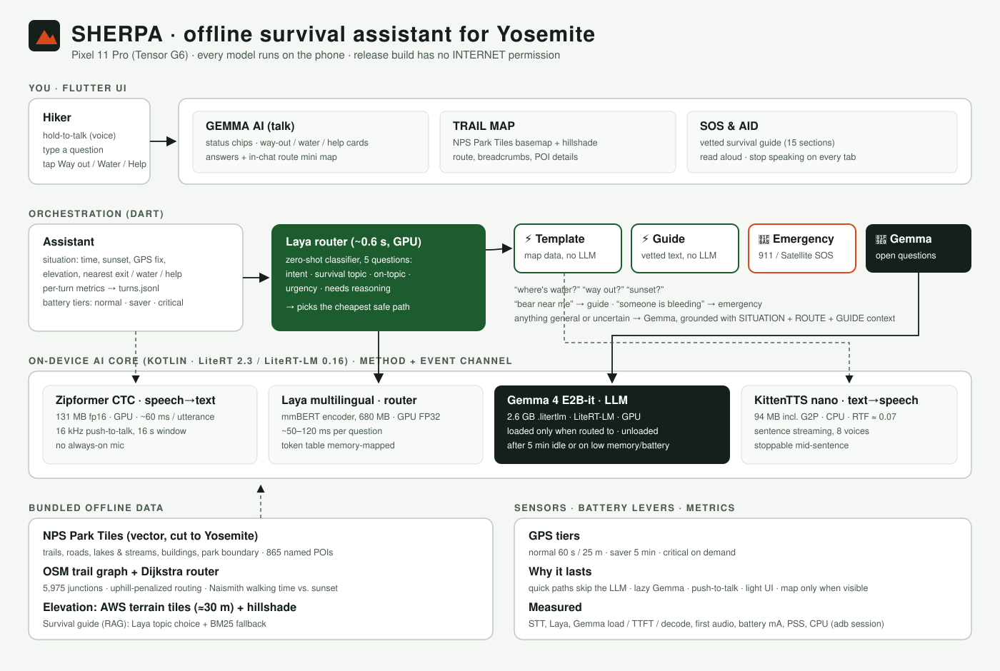
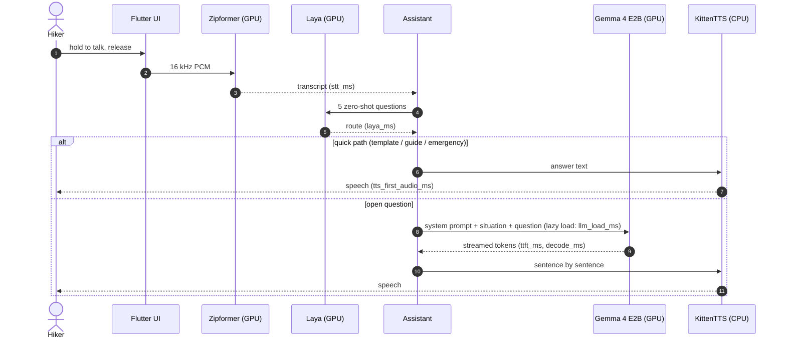

# Sherpa: architecture at a glance



Everything below runs on a Pixel 11 Pro (Tensor G6), offline. The release build has no INTERNET permission.

## Components

```mermaid
flowchart TB
  user([Hiker: voice / text / cards])

  subgraph UI[Flutter UI]
    talk[GEMMA AI tab<br/>cards, answers, in-chat route mini map]
    map[TRAIL MAP tab<br/>NPS basemap + hillshade, route, POIs]
    sos[SOS & AID tab<br/>survival guide, read aloud]
  end

  subgraph ORCH[Orchestration · Dart]
    asst[Assistant<br/>situation: time, sunset, GPS, nearest exit/water/help<br/>per-turn metrics]
    laya{{Laya router<br/>intent · topic · on-topic · urgency · needs-reasoning}}
    tpl[⚡ Template<br/>map data, no LLM]
    guide[⚡ Guide<br/>vetted text, no LLM]
    sosx[🚨 Emergency script]
    llm[🧠 Gemma path<br/>SITUATION + ROUTE + GUIDE context]
  end

  subgraph CORE[On-device AI core · Kotlin · LiteRT / LiteRT-LM]
    stt[Zipformer CTC<br/>speech→text · GPU · 131 MB]
    lay[Laya multilingual<br/>zero-shot · GPU · 680 MB]
    gem[Gemma 4 E2B-it<br/>LLM · GPU · 2.6 GB · lazy load]
    tts[KittenTTS nano<br/>text→speech · CPU · 94 MB]
  end

  subgraph DATA[Bundled offline data]
    nps[NPS Park Tiles<br/>trails, roads, water, 865 POIs]
    graph[OSM trail graph<br/>Dijkstra + Naismith]
    dem[Elevation 30 m<br/>+ hillshade]
    kb[Survival guide<br/>RAG: Laya topic + BM25]
  end

  gps[[GPS · battery tiers]]

  user --> UI --> asst
  user -- hold to talk --> stt --> asst
  asst --> laya --> lay
  laya --> tpl & guide & sosx & llm
  llm --> gem
  tpl & guide & sosx & gem --> tts --> user
  tpl --> graph & dem
  map --> nps & dem
  guide & llm --> kb
  gps --> asst
```

## One spoken turn



## Measuring it

- **Per-turn log:** the app appends one JSON line per turn to `/sdcard/Android/data/com.hackathon.yosemite_survival/files/metrics/turns.jsonl`. Each line holds:
  - STT, Laya, Gemma load / TTFT / decode and first-audio times
  - battery %, current, temperature
  - app memory (PSS) and CPU time
- **Session script:** `tool/metrics_session.ps1` samples the system every 5 s over adb, pulls the logs, and writes `metrics/<timestamp>/summary.md`.
- **Router calibration:** `adb shell am start -n com.hackathon.yosemite_survival/.MainActivity --ez calibrate true` writes `metrics/calibration-*.jsonl`.
