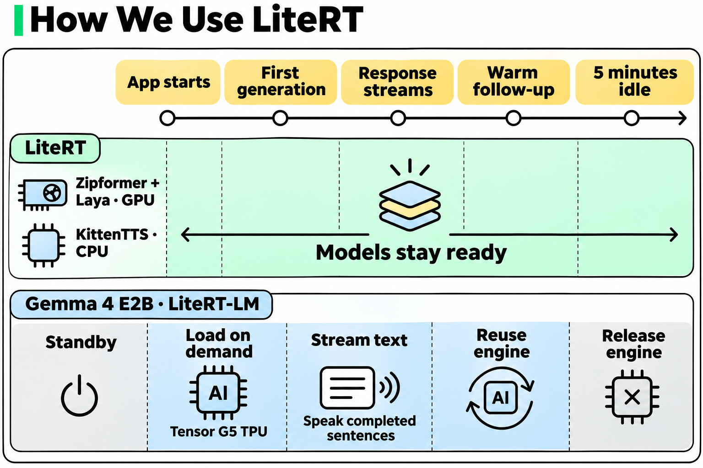
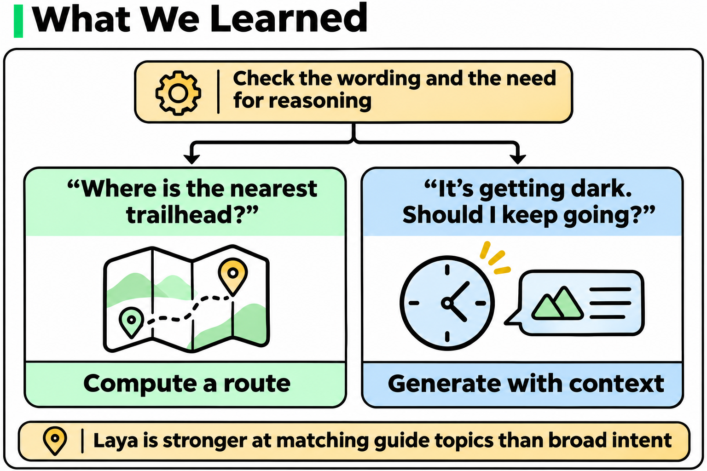

# Sherpa Survival: An offline hiking assistant with Gemma and LiteRT

## The problem

An offline map can show a trail winding back to the trailhead. Working out whether that’s a short walk or a steep hour uphill takes more information. We built Sherpa because the phone already has much of that information, from the terrain around the next bend to how far the hiker has moved in the last hour. We wanted it to put those details together in an answer that works in the backcountry.

## What we built

We built Sherpa in Flutter for Android and iOS. A steep shortcut can take longer than a route that looks less direct on the map, so the app computes the route and walking estimate before the assistant explains them.

The trail router gives each segment a cost based on distance and uphill climb. Dijkstra’s algorithm searches those costs, and a Naismith estimate turns the result into walking time. Retrace uses a separate record. While tracking, Sherpa records a new GPS fix if it is at least 25 metres from the previous breadcrumb or arrives at least two minutes later. The saved track can include stretches away from mapped trails, and it gives the assistant a measure of recent progress.

For questions that draw on the guide, BM25 ranks passages by how closely they match the words in the question. The app can also pass the guide section suggested by Laya to Gemma. Photos are resized to a maximum of 640 pixels on the longest edge to limit vision tokens, then compressed as JPEG.

## How we used LiteRT

We started with preconverted model files from LiteRT Community. We could use the hackathon to integrate the models and test them together on the phone. [Zipformer CTC](https://huggingface.co/litert-community/Zipformer-medium-CR-CTC-LiteRT) · [Laya Multilingual](https://huggingface.co/litert-community/Laya-Multilingual-LiteRT) · [Gemma 4 E2B-it](https://huggingface.co/litert-community/gemma-4-E2B-it-litert-lm) · [KittenTTS Nano](https://huggingface.co/litert-community/kitten-tts-nano-0.8) · [Matcha-TTS phonemizer assets](https://huggingface.co/litert-community/Matcha-TTS)

On Android, Flutter sends requests to Kotlin over a `MethodChannel` and receives streamed response events over an `EventChannel`. For Laya, the native layer reuses input and output buffers from LiteRT’s `CompiledModel` API across classification calls.

The Tensor-specific Gemma bundle and the standard bundle are separate files. If the Tensor bundle fails to initialize, Sherpa can retry on the GPU when the standard bundle is installed.

### How well Sherpa performs

Route details and guide excerpts lengthen the prompt, so the cost of processing that context matters even for a one-sentence answer. For the voice measurements, we timed each component in isolation using Sherpa’s implementation. The workload included transcribing five seconds of audio, scoring four routing criteria, and synthesizing a passage that produced about nine seconds of audio. [Gemma benchmark data](../benchmarks/pixel-10-pro/README.md#gemma-generation) · [Voice pipeline benchmark data](../benchmarks/pixel-10-pro/README.md#sherpa-voice-pipeline)

## Demo

The walkthrough shows the hackathon build in use. [Watch the demo on YouTube](https://www.youtube.com/shorts/p-rF7Cr_h_8) · [Explore the Sherpa Survival repository](https://github.com/dev-ansung/sherpa-survival)

## What we learned

During calibration, we found that two questions could use the same trail vocabulary and still need very different answers. We let explicit wording identify a possible lookup and use Laya’s reasoning score as a veto. That keeps the shortcut available for simple questions while preserving the option to give a fuller answer.

The settings screen turned into a debugging tool. Switching the model bundle, accelerator, and speech engine on the phone let the team reproduce behavior without rebuilding the app. For another project with several on-device models, we’d add those controls early and measure the time to the first token or first audio separately from the time to finish the response.

## What’s next

We’ll test a second park end to end, with particular attention to how route estimates behave around junctions and gaps in the trail graph. We also want a way to check that a region is ready before heading out.

## Team

We built Sherpa at the Google Gemma Hardware Hackathon at AGI House.

- An Sung · [LinkedIn](https://www.linkedin.com/in/dev-ansung/)
- Anirudh Kulkarni · [LinkedIn](https://www.linkedin.com/in/anirudh-kulkarni1/)
- Chengjiang Long · [LinkedIn](https://www.linkedin.com/in/chengjiang-long-a7702478)
- Grace Huang · [LinkedIn](https://www.linkedin.com/in/gracehthuang/)
