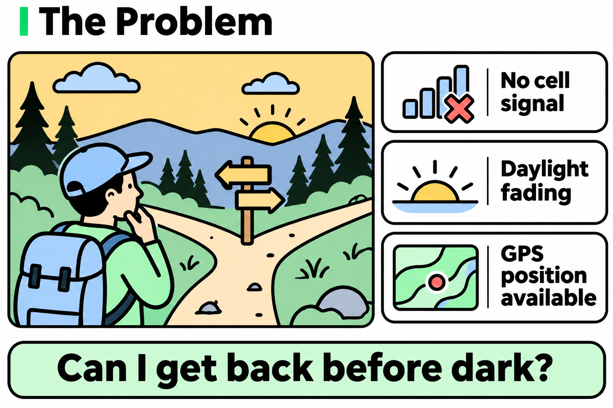
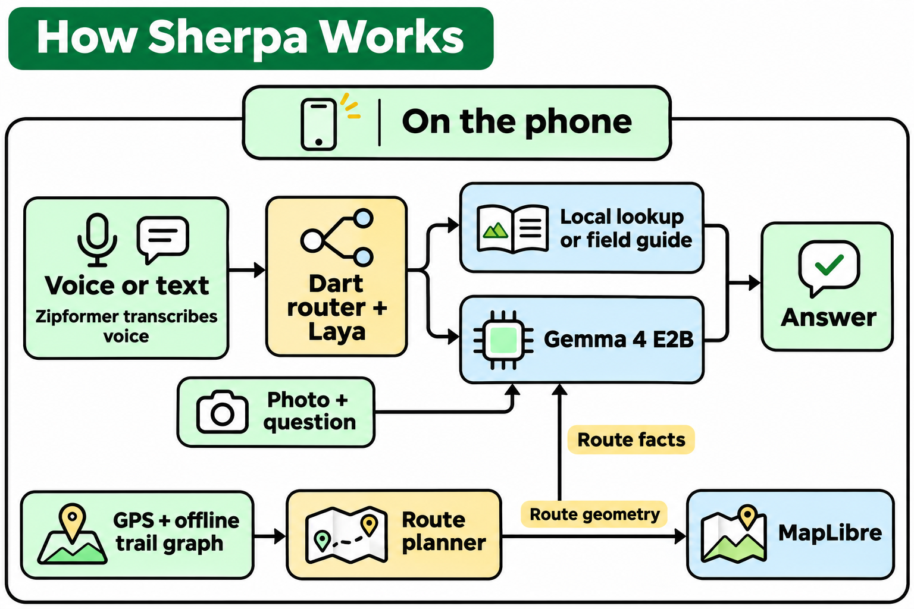
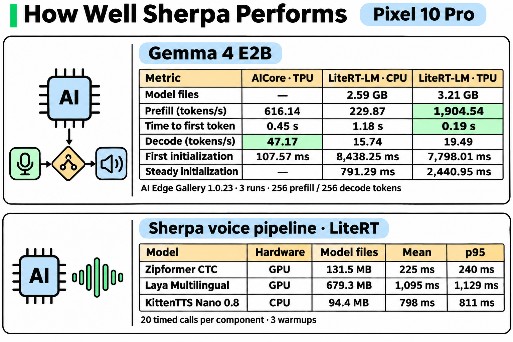
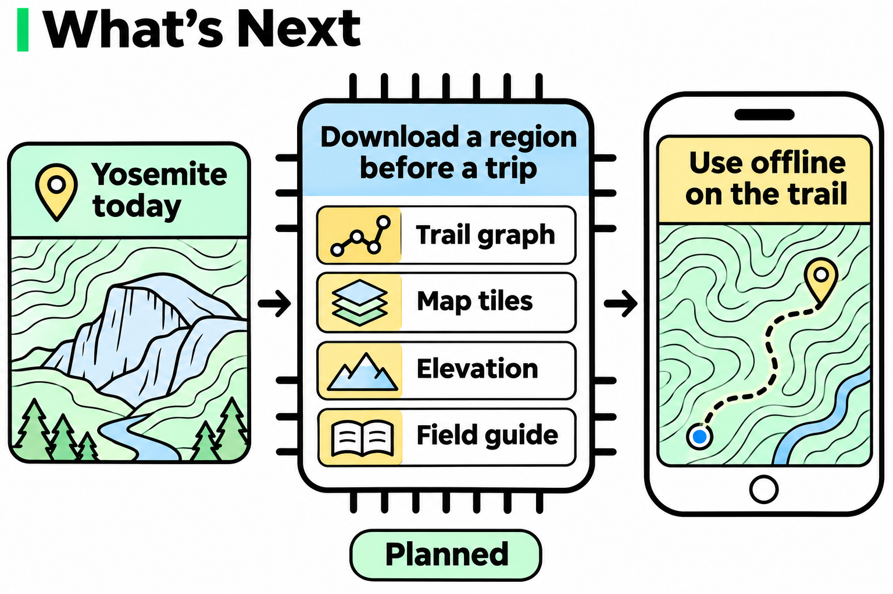

# Sherpa Survival: An offline hiking assistant with Gemma and LiteRT

## The problem

An offline map can show the way back to the trailhead. Working out how long it will take means factoring in the climb and how much ground you’ve covered in the past hour. We built Sherpa to put that information together on the phone, where the map and the models share memory and every answer draws from the same battery. We made Sherpa voice-first so hikers can ask a question when their hands are busy. They can also type a question or attach a photo.

## What we built

We built Sherpa in Flutter for Android and iOS. A steep shortcut can take longer than a route that looks less direct on the map, so the app computes the route and walking estimate before the assistant explains them.

The trail router gives each segment a cost based on distance and uphill climb. Dijkstra’s algorithm searches those costs, and a Naismith estimate turns the result into walking time. Retrace uses a separate record. While tracking, Sherpa records a new GPS fix if it is at least 25 metres from the previous breadcrumb or arrives at least two minutes later. The saved track can include stretches away from mapped trails, and it gives the assistant a measure of recent progress.

For questions that draw on the guide, BM25 ranks passages by how closely they match the words in the question. The app can also pass the guide section suggested by Laya to Gemma. Photos are resized to a maximum of 640 pixels on the longest edge to limit vision tokens, then compressed as JPEG.

## How we used LiteRT

We integrated four models into a single native Kotlin layer on Android and pinned its LiteRT dependencies to version 2.3.0. Starting with preconverted models from LiteRT Community gave us time to test the full pipeline on a Pixel during the hackathon. [Zipformer CTC](https://huggingface.co/litert-community/Zipformer-medium-CR-CTC-LiteRT) · [Laya Multilingual](https://huggingface.co/litert-community/Laya-Multilingual-LiteRT) · [Gemma 4 E2B-it](https://huggingface.co/litert-community/gemma-4-E2B-it-litert-lm) · [KittenTTS Nano](https://huggingface.co/litert-community/kitten-tts-nano-0.8) · [Matcha-TTS phonemizer assets](https://huggingface.co/litert-community/Matcha-TTS)

On Android, Flutter sends requests to Kotlin over a `MethodChannel` and receives streamed response events over an `EventChannel`. For Laya, the native layer reuses input and output buffers from LiteRT’s `CompiledModel` API across classification calls.

The Tensor-specific Gemma bundle and the standard bundle are separate files. If the Tensor bundle fails to initialize, Sherpa can retry on the GPU when the standard bundle is installed.

### How well Sherpa performs

Route details and guide excerpts lengthen the prompt, so the cost of processing that context matters even for a one-sentence answer. For the voice measurements, we timed each component in isolation using Sherpa’s implementation. The workload included transcribing five seconds of audio, scoring four routing criteria, and synthesizing a passage that produced about nine seconds of audio. [Gemma benchmark data](../benchmarks/pixel-10-pro/README.md#gemma-generation) · [Voice pipeline benchmark data](../benchmarks/pixel-10-pro/README.md#sherpa-voice-pipeline)

## Demo

The walkthrough shows the hackathon build in use. [Watch the demo on YouTube](https://www.youtube.com/shorts/p-rF7Cr_h_8) · [Explore the Sherpa Survival repository](https://github.com/dev-ansung/sherpa-survival)

## What we learned

During calibration, we found that two questions could use the same trail vocabulary and still need very different answers. We let explicit wording identify a possible lookup and use Laya’s reasoning score as a veto. That keeps the shortcut available for simple questions while preserving the option to give a fuller answer.

We had fun challenging each other on which problem was worth solving, then narrowed the build to three features. With only a few hours and a stack that was new to most of us, we used Google AI Studio and Claude to prototype while the rest of the team tried things on a real Pixel. Our biggest surprise was how useful a simple Settings screen became. Switching the model, accelerator, or text-to-speech voice on the spot made it easier to show different configurations in the demo. We’d keep the scope tight and test on the actual device early again.

## What’s next

We plan to refine the router, prompts, and guide retrieval so Sherpa chooses the right response more consistently and its answers sound more natural. On the map side, we’ll add richer offline trail data for more accurate routes. A second park will give us a way to test those improvements as we expand beyond Yosemite.

## Team

We built Sherpa at the Google Gemma Hardware Hackathon at AGI House.

- An Sung · [LinkedIn](https://www.linkedin.com/in/dev-ansung/)
- Anirudh Kulkarni · [LinkedIn](https://www.linkedin.com/in/anirudh-kulkarni1/)
- Chengjiang Long · [LinkedIn](https://www.linkedin.com/in/chengjiang-long-a7702478)
- Grace Huang · [LinkedIn](https://www.linkedin.com/in/gracehthuang/)
