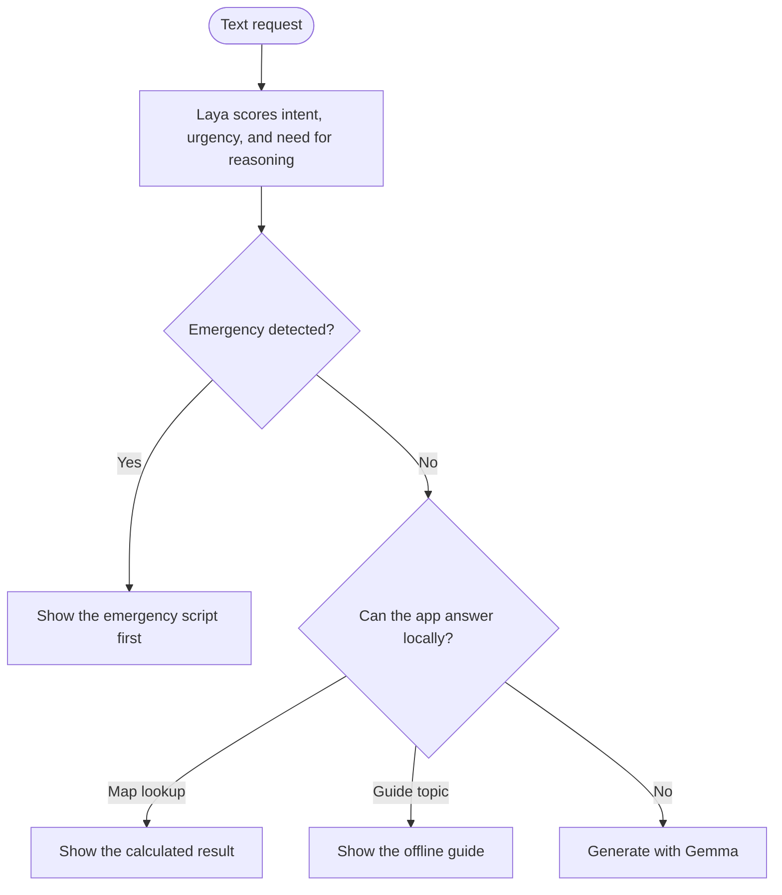

# Sherpa Survival: Offline AI Assistant for Outdoor Adventures

You’re on a camping trip, walking on a quiet trail when it starts to rain. It’s getting dark, and it’s been a while since you passed a trail marker. You stop to check the map on your phone. No signal.

Then you remember you installed Sherpa Survival. You open it and see your position, the nearby trails, and the path you’ve walked so far.

As you are walking back to the trailhead, you see faint shadow of a bear in distance, and your heart races. You quickly whisper to Sherpa Survival, "I see a bear. What should I do?", instead of waiting for inference to generate token by token, the assistant immediate response "Stay calm, do not approach the bear, and slowly back away while keeping it in sight."

At distance, you use camera mode to take a photo of the bear, the assistance analyzes the image and tells you it is a black bear, which is generally not aggressive unless provoked.

You later went back to your campsite safely, and ask assistant for "how to start a fire"...

We built Sherpa Survival to make that possible on Android and iOS.

Both platforms run Gemma through LiteRT-LM, with an optimized model bundle for compatible Android phones with Google Tensor. The sections below explain how the model, location history, maps, and routing fit together.

## Local Model Capabilities/Limitations

Sherpa’s map and field guide run independently of the language model. LiteRT-LM loads **Gemma 4 E2B** when a request needs generation, reuses the engine for follow-ups, and releases it after five minutes of inactivity. Keeping the engine warm reduces the wait on the next request. Releasing it frees memory for the rest of the phone.

Sherpa uses E2B and can retry with an installed generic bundle if the optimized model fails to load.

| Standard LiteRT-LM bundle | Gemma 4 E2B-it | Gemma 4 E4B-it |
| --- | ---: | ---: |
| Effective parameters | 2.3B | 4.5B |
| Model file on disk | 2,583 MB | 3,654 MB |

**On-device inference by hardware and backend**

| Hardware & Backend | Prefill Speed (tk/s) | Time to First Token (TTFT) | Decode Speed (tok/s) | Peak CPU RAM Usage |
| --- | ---: | ---: | ---: | ---: |
| iPhone GPU (Metal) | 2,800 – 3,800+ | ~0.1s – 0.3s (Lowest) | 50 – 60+ tok/s (Fastest) | ~1.4 GB |
| Pixel TPU/NPU (Tensor Delegate) | 2,500 – 3,500 | ~0.2s – 0.4s | 30 – 45 tok/s | ~0.7 – 1.0 GB (Lowest) |
| Pixel GPU (OpenCL/Vulkan) | 2,000 – 3,000 | ~0.3s – 0.5s | 40 – 50 tok/s | ~1.0 – 1.2 GB |
| iPhone CPU (XNNPACK) | ~500 – 550 | ~1.8s – 1.9s | ~25 tok/s | ~0.6 GB |
| Pixel CPU (XNNPACK) | ~300 – 450 | ~1.6s – 2.2s (Slowest) | ~10 – 18 tok/s (Slowest) | ~1.5 – 1.7 GB (Highest) |

These reference ranges are grouped by backend. Device models, model bundles, and test conditions are unspecified. Sherpa’s end-to-end timings remain pending.

> **[Architecture diagram]** Show the map and guide outside the model lifecycle. Trace Gemma’s load, reuse, and release states. Show the retry with an installed generic bundle.
>
> **[Generated mobile screen]** Show model settings with the installed bundle, requested accelerator, and load status. Omit sample performance figures.

## Geolocation Integration

A location fix contains latitude, longitude, time, accuracy, and device altitude when available. While tracking is active, Sherpa adds a breadcrumb when a new fix is at least 25 metres from the last recorded point or at least two minutes newer. The saved track contains latitude, longitude, and timestamps. For current elevation, Sherpa looks up the position in its offline elevation grid and falls back to device altitude when the grid has no value.

The track serves two purposes. **Retrace** draws the recorded points in reverse. For inference, Sherpa adds up the distances between recent points and tells Gemma how far the user moved in the last hour. That gives the model a measure of recent progress, including time spent stopped.

The route planner calculates its walking estimate separately. It uses the route’s distance and ascent, with a fixed pace adjustment. Gemma can see both the route estimate and the user’s recent progress when explaining how long the walk might take. The following excerpt uses illustrative values.

```text
[SITUATION] Elevation 1,380 m. Moved 1.2 km in the last hour.
[ROUTE] Trailhead, 1.8 km, +120 m, about 44 minutes walking.
```

> **[Architecture diagram]** Show timestamped GPS points feeding Retrace and the last-hour distance calculation. Show current position feeding the elevation lookup and route planner. Pass recent progress, elevation, and the route estimate into Gemma’s context.
>
> **[Generated mobile screen]** Show the recorded track and current elevation alongside a route card. Label recent progress and estimated time remaining separately.

## Map Rendering Integration

The offline map pack stores trails as a network of connected segments. Each segment carries its shape, length, and elevation change. Named places such as trailheads and water sources are stored as points on the map. A separate elevation grid gives the app a height for any position within the covered area. Together, those layers let Sherpa calculate a route and draw it on the map.


**2D navigation.** FlutterMap starts with a shaded terrain image positioned over the area it covers. It draws trails, roads, and water on top, then overlays the user’s position, recorded track, and calculated route. Smaller features such as streams and parking areas appear as you zoom in.

**3D map viewer.** The viewer opens on the north-up Park map. Tap **3D** to tilt the view and switch to aerial imagery when it’s available. MapLibre uses local elevation tiles to shape the terrain and drapes the selected map layer over it. Trails and landmarks stay visible as you switch views.

> **[Generated mobile screen]** Show the same area in the navigation map and the terrain viewer’s default Park map view. Keep the 3D toggle visible.

## Multimodal Integration

Hold the mic to record and release it to finish. On-device speech recognition turns the recording into a transcript. The assistant handles that text the same way it handles a typed question.

We considered sending audio directly to Gemma 4 E2B. Transcribing first gives Laya the text it needs to route the request before Gemma loads.


We cap photos at 640 pixels on the longest side and compress them as JPEG before sending them to Gemma.


> **[Generated mobile screen]** Show the question composer with an original photo attached. Keep the attachment, text field, and send controls visible.

## Decision Model Integration

**Laya** scores intent, urgency, and the need for reasoning. Its classifier runs on the GPU through LiteRT. Application rules combine those scores with cues in the request to select an answer path. A local lookup can complete with Gemma unloaded. The interface labels each answer with its source.



*Laya supplies scores. App rules use them alongside cues in the text to select the answer source.*

> **[Generated mobile screen]** Show a local lookup and a generated answer in the same interface, with the source of each visible.

## Closing

| Offline path | What the app does | End-to-end timing |
| --- | --- | --- |
| Retrace | Draws the recorded track in reverse | Pending |
| Guide lookup | Reads the bundled entry | Pending |
| Photo question, cold engine | Loads Gemma, then processes the image and question | Pending |
| Photo question, warm engine | Reuses Gemma for the image and question | Pending |

Sherpa’s time-to-first-token timer begins after model loading. The cold path includes that extra wait before the timer starts.

> **[Architecture diagram]** Show an offline test sequence covering Retrace, guide lookup, and cold and warm generation. Mark the start and end of each timing measurement.
>
> **[Generated mobile screen]** Show a test session in airplane mode with the answer source and selected model visible. Leave the timing values blank until measured.
